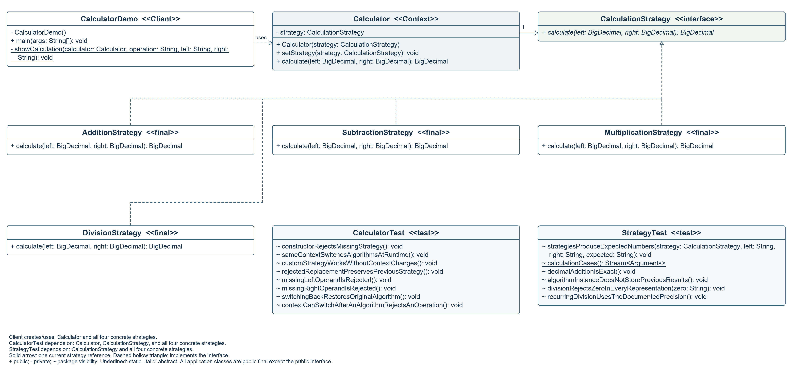

# Strategy Calculator

Assignment 5 for Software Design Patterns. Java 17, suggested Calculator topic.

## Run in IntelliJ IDEA

1. Extract the complete project if you downloaded a ZIP.
2. Open the inner folder containing `pom.xml`, `src`, and `run-demo.cmd`.
3. Open `pom.xml` as a Maven project and select JDK 17 or later.
4. Wait for Maven import, then open `src/main/java/edu/aitu/strategy/client/CalculatorDemo.java`.
5. Use the green Run arrow beside `main()`. No program arguments are needed.

The shared **Strategy Calculator Demo** configuration is included.

## Run on Windows without Maven

Double-click `run-demo.cmd`. It locates a JDK, compiles production classes, runs the same demonstration, and leaves the console open. A JDK with javac is required. The launcher checks JAVA_HOME, IntelliJ-managed JDKs, Program Files Java installations, and PATH.

For unattended execution: `run-demo.cmd --no-pause`.

## What the demonstration shows

The client creates one Calculator and replaces its CalculationStrategy at runtime. With the same operands **20 and 4**, addition produces **24**, subtraction **16**, multiplication **80**, and division **5**. Extra examples show decimals, negative numbers, recurring division, rejection of a zero divisor, recovery, and switching back.

The context delegates through the interface and has no if, switch, instanceof, or concrete strategy references. The client is the composition root and chooses the algorithms.

See the actual [62-line console transcript](docs/demo-output.txt).

## Build and test

JDK 17 or later and Maven are required. The first Maven build may download JUnit and plugins. Production code uses only the Java standard library.

```shell
mvn verify
java -jar target/strategy-calculator-1.0.0.jar
```

The context validates non-null inputs. Strategies operate on BigDecimal values. Addition, subtraction, and multiplication are exact decimal operations. Division uses DECIMAL64: 16 significant digits and HALF_EVEN rounding; a zero divisor raises ArithmeticException.

## Assignment deliverables

- [Required short Markdown reflection](reports/strategy-pattern-report.md).
- [English Word report](reports/strategy-pattern-report.docx).
- [Complete UML image](docs/class-diagram.png) and [editable PlantUML](docs/class-diagram.puml).
- [All source declarations and local variables](docs/uml-inventory.md).
- [Validation results](docs/validation.md) and [requirements checklist](docs/requirements-checklist.md).
- [Simple English defense notes](docs/defense-notes.md).

The Clean Code section applies Chapters **9 Unit Tests**, **10 Classes**, and **11 Systems**. Each of seven applications includes an annotated implementation excerpt.

## Complete UML



All 6 application classes, the strategy interface, and 2 test classes are included: **8 classes and 1 interface**. The inventory contains **1 field, 23 methods, and 2 explicit constructors**, including private helpers. Local variables have method scope and are listed separately. External Java and JUnit types and generated lambda classes are outside the authored-type count.

## Extension history

The first implementation has three strategies. A later commit adds DivisionStrategy while leaving Calculator, CalculationStrategy, and the existing strategies unchanged. The client configuration and tests are updated to use division. This is the intended extension point: adding an algorithm does not require editing the context's calculation logic.

## Structure

```text
src/main/java/edu/aitu/strategy/
  algorithm/   common interface and four arithmetic strategies
  context/     Calculator
  client/      CalculatorDemo
src/test/java/edu/aitu/strategy/  two JUnit test classes
.run/          shared IntelliJ run configuration
docs/          UML, inventory, transcript, criteria, and validation
reports/       Markdown reflection and Word report
```

Repository: https://github.com/ramazanutegen583-pixel/strategy-pattern-calculator
